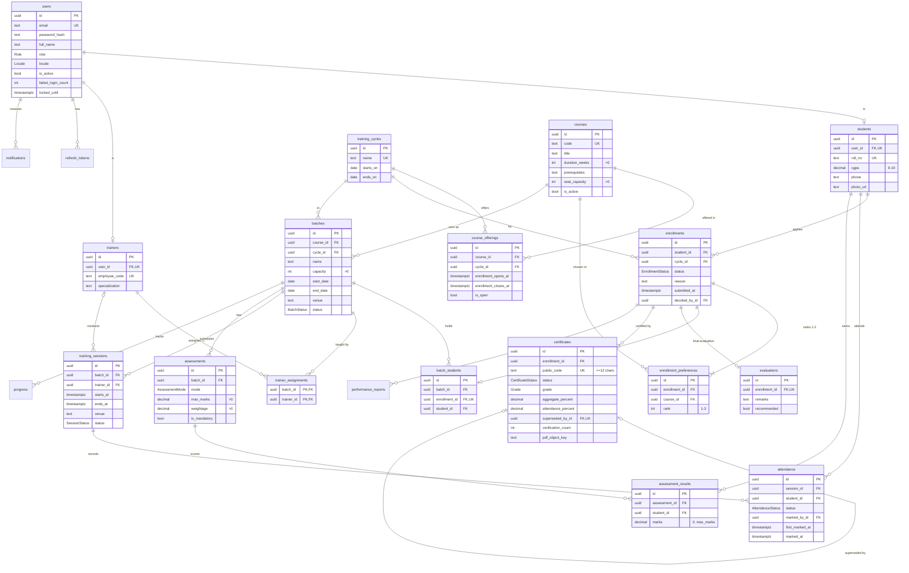
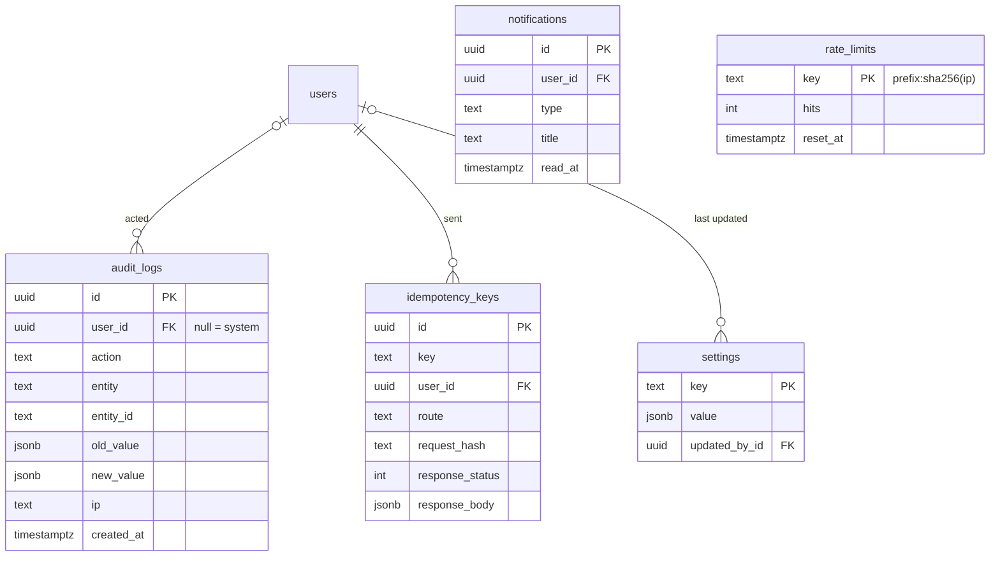
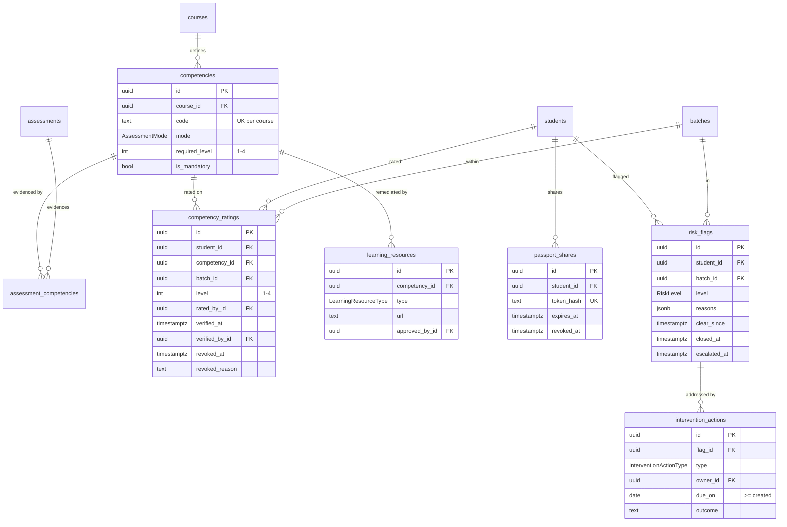
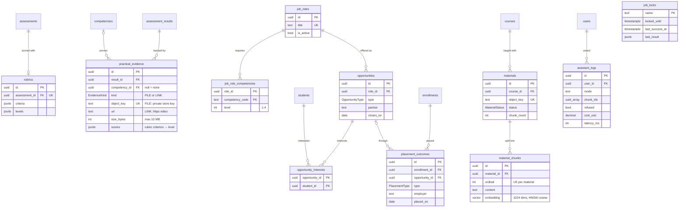

# KISS VTMP — Entity–Relationship Summary

Source of truth: [`prisma/schema.prisma`](../prisma/schema.prisma) plus the hand-written SQL at the
end of `prisma/migrations/*_r1_r2_schema/migration.sql`. Tables use UUID keys, snake_case names
and an index on every foreign key. This covers Release 1 (core) and Release 2 (competency,
passport, intervention); R3 tables are added in Sprints 11–12.

## Core workflow (R1)

## Kernel tables

`rate_limits` (infrastructure, added for serverless hosting) holds fixed-window counters for the
security rate limits, so every Vercel function instance shares one count. Keys are hashed, and
no raw IPs are stored.

## Competency, passport and intervention (R2)

## Evidence, opportunities, analytics and assistant (R3)

- **Job roles name competency codes**, not competency rows: one role ("Solar technician") can
  match courses that share codes. A student's match % is computed on read (BR-22).
- **Outcome analytics** read two materialized views refreshed nightly,
  `analytics_batch_outcomes` and `analytics_course_competency` (counts only); rates are
  computed on read so changed Settings apply at once.
- **`job_locks`** is the lease that keeps two runs of a scheduled job from overlapping, and
  remembers the last success and left-over work so the next run can catch up.
- **Assistant** tables are used only when the assistant is switched on (`AI_ENABLED`); it is
  off on the live site.

## Rules enforced by the database

| Rule | Mechanism |
| --- | --- |
| BR-01 one active enrollment per student per cycle | Partial unique index `enrollments_one_active_per_cycle` on (student_id, cycle_id) where status not in (REJECTED, NOT_COMPLETED) |
| BR-07 0 ≤ marks ≤ max | CHECK `marks >= 0` + trigger `assessment_results_marks_within_max`; trigger on assessments blocks lowering max below an existing result |
| NFR-06 / BR-12 audit log immutable | Triggers on `audit_logs` reject UPDATE, DELETE and TRUNCATE |
| F11 one open flag per student and batch | Partial unique index `risk_flags_one_open_per_student_batch` where closed_at is null |
| F15 one VALID certificate per enrollment | Partial unique index `certificates_one_valid_per_enrollment` where status = VALID |
| BR-19 certificate codes ≥ 12 chars | CHECK `certificates_public_code_length` |
| Certificates only for passing grades | CHECK `grade <> 'NOT_COMPLETED'` |
| Revocations carry a reason | CHECKs on certificates and competency_ratings |
| Ranges | rank 1–3, competency levels 1–4, CGPA 0–10, capacity/duration/max marks/weightage > 0, date and time ordering, due_on ≥ created date |
| Evidence is a file or a link, never both | CHECK `practical_evidence_file_or_link`; files ≤ 10 MB |
| Job role levels 1–4 | CHECK `job_role_competencies_level_range` |
| Foreign keys are indexed | Every foreign key has an index starting with its columns (checked by a test) |
| Membership matches its enrollment | Composite FK batch_students(enrollment_id, student_id) → enrollments(id, student_id) |

Derived values (attendance %, aggregate, gap, match %) are never stored, except the frozen
snapshots on `certificates` and `performance_reports`.
